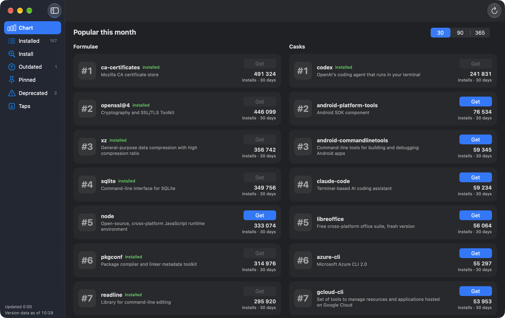
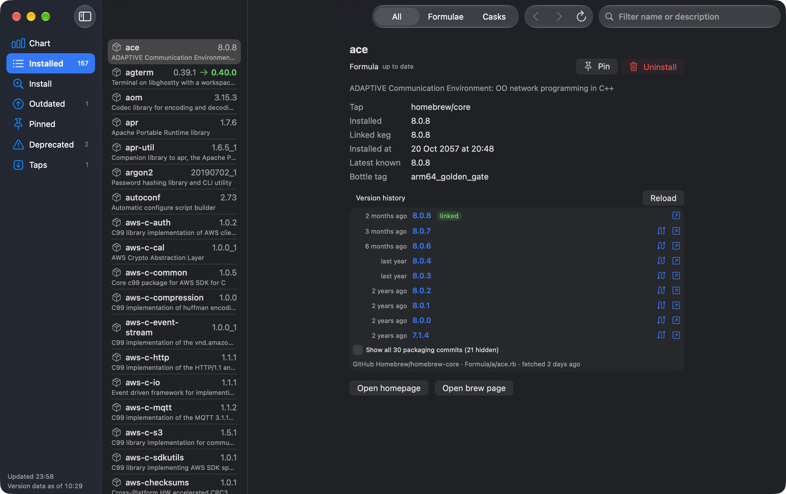
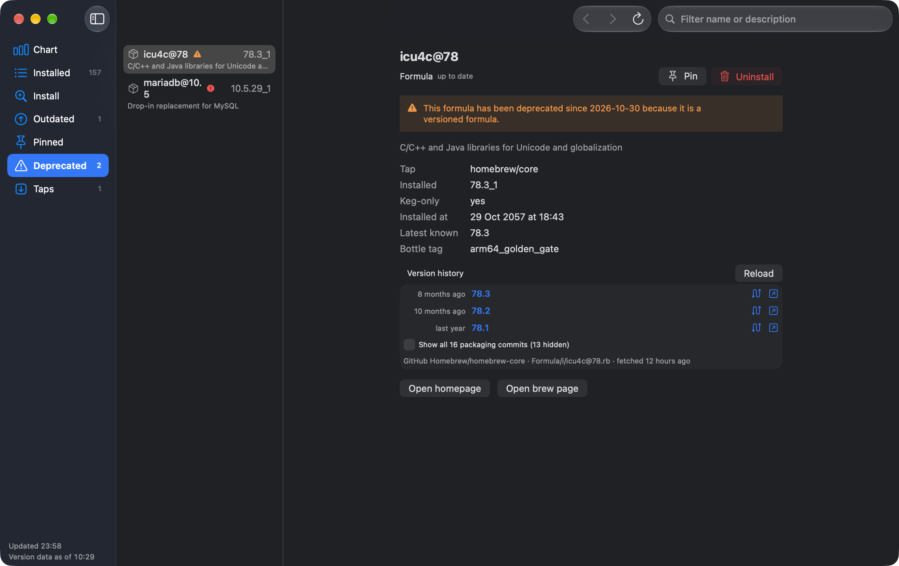
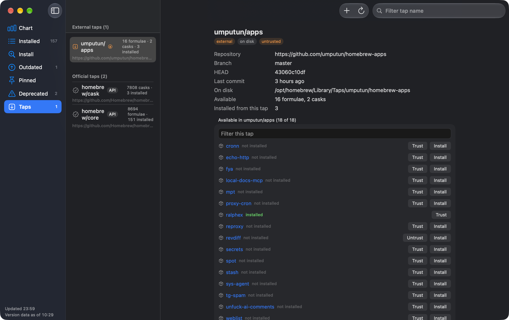

# Brewery

A macOS SwiftUI app to inspect and drive an installed [Homebrew](https://brew.sh) setup:
formulae, casks, taps, outdated and pinned packages, version histories, and daily
update notifications — without ever touching Homebrew's internals.

**Status:** early personal project (v0.2.1). It works on the author's machine and is
verified against Homebrew 7.0.11, but it is not polished for general consumption.
Not affiliated with or endorsed by the Homebrew project.

## Screenshots

| Chart | Installed |
|:---:|:---:|
|  |  |

| Deprecated | Taps |
|:---:|:---:|
|  |  |

## Features

- **Inventory sidebar** — All / Formulae / Casks / Outdated / Pinned / Deprecated /
  Taps, plus a "Brew" view of top installs from the formulae.brew.sh API.
- **Package pages** — version history, changelog rendering, deprecation notices,
  reverse dependencies, per-package actions.
- **Drive actions** — pin/unpin and tap management run as explicit `brew`
  invocations through a single-flight guard (one brew at a time, brew's own error
  wording surfaced verbatim). Nothing installs or uninstalls by itself.
- **Update notifications** — optional daily background check installed as a
  LaunchAgent; the same binary doubles as a headless `--check-updates` runner and
  delivers results through UserNotifications.

## Requirements

- macOS 26+
- Swift 6.3+ toolchain (Xcode 26.6 command line tools or newer; CI builds with 6.3.3)
- Homebrew installed (verified against 7.0.11; `jq` available for `brew list --json`)

## Build and run

```sh
swift test                  # 210 tests, all core logic
./Tools/make-app-bundle.sh  # release build → build/Brewery.app (ad-hoc codesigned)
open build/Brewery.app
```

`swift run BreweryApp` also works but runs outside an app bundle: no Dock icon, no
stable bundle identity.

## How it integrates with Homebrew

Homebrew has **no stable public API**. Brewery sticks to the surfaces Homebrew
documents as supported: the CLI's `--json` output, documented `HOMEBREW_*`
environment variables, the `formulae.brew.sh` JSON API, and the on-disk layout.
It never links against `Library/Homebrew` Ruby code.

What is verified safe to call — and the gotchas (schema drift, `--json`
inconsistencies, auto-update interference, JWS manifest decoding) — is written up
in [`docs/compatibilities.md`](docs/compatibilities.md). Design decisions live in
[`docs/design/`](docs/design).

## Layout

| Path | What |
|---|---|
| `Sources/BreweryCore` | Foundation-only models, JSON parsing, merging, policies — no UI, unit-tested |
| `Sources/BreweryApp` | SwiftUI app: sidebar, package/tap pages, settings, notifications coordinator, headless launcher |
| `Tests/BreweryCoreTests` | 210 tests incl. adversarial fixtures of real brew output |
| `Tools/` | app bundle + icon build scripts |
| `docs/` | compatibility list, design docs, implementation plans |

## Thanks

- [Homebrew](https://brew.sh) and its [documentation](https://docs.brew.sh) — the
  project this app is built to serve. All of the integration research is answers
  to questions brew's docs already framed.
- The **swiftui-pro** and **swiftui-expert** Claude Code skills — the SwiftUI
  guidance that shaped this app's UI code.

## License

MIT — see [LICENSE](LICENSE).
